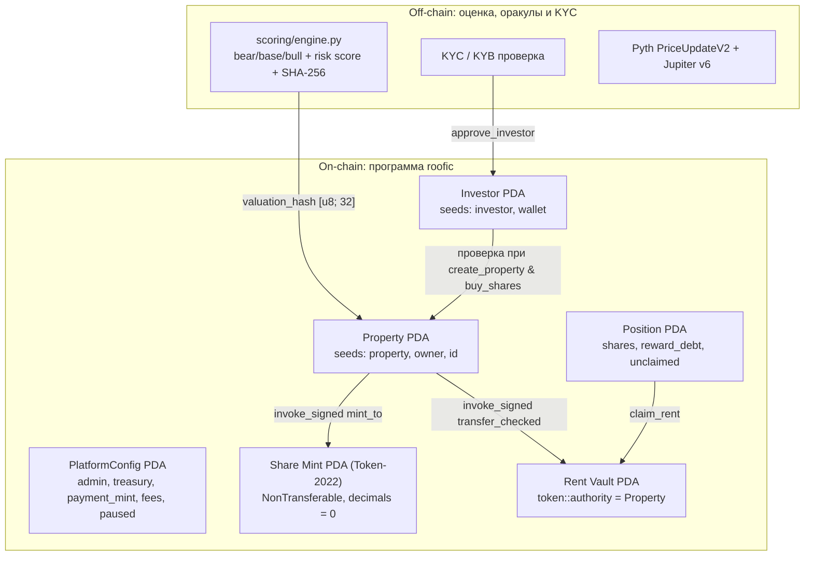

# Неделя 14 — Capstone: платформа Roofic

| | |
|---|---|
| **Задание** | Собрать финальный прототип продукта, объединяющий смарт-контракты, токенизацию, платежи в стейблкоинах, безопасность и аналитический модуль |
| **РО** | РО5 — комплексная разработка и защита блокчейн-проекта на Solana |
| **Program ID (Devnet)** | [`EvLmbfYUs5m5YHWm4QWCeQfy63df4BBiaBiZw8Rf12mo`](https://explorer.solana.com/address/EvLmbfYUs5m5YHWm4QWCeQfy63df4BBiaBiZw8Rf12mo?cluster=devnet) (initial deploy: [`5FZYeii7…xb83yYNSQ`](https://explorer.solana.com/tx/5FZYeii7wHmjr4EBvPequQmRRSiEFxefjv2uXUkag66tZiddX92YVX5XehSo4gNSMTwUyuKNM4sLUgwxb83yYNSQ?cluster=devnet), security upgrade: [`2rJXtP4V…cRkE2eW6M`](https://explorer.solana.com/tx/2rJXtP4VXajKRCDarQHxpj94o3BsqKKCCxoSnTsGhcLefetfJvqqNJ7hGqBbYCXWzkp7Zr9uqEpsHhVcRkE2eW6M?cluster=devnet)) |

## Что изменилось от MVP (неделя 8) к Capstone

| Компонент | MVP (неделя 8) | Capstone (неделя 14) |
|-----------|----------------|----------------------|
| **Валюта расчётов** | Нативный SOL (курсовой риск) | Стейблкоин (USDC / PYUSD) через `TokenInterface` + `transfer_checked` с проверкой отсутствия `TransferFee`/`TransferHook`/`PermanentDelegate` у `payment_mint` |
| **Доля объекта** | Только запись `Position` | `Position` + токен **Token-2022** (`0 decimals`, расширение `NonTransferable`, mint authority = PDA объекта); учёт `shares_sold` защищён от burn-атак |
| **Доступ инвесторов и эмитентов** | Любой кошелёк | Ончейн **KYC/KYB allow-list** (`approve_investor` / `revoke_investor`): обязателен и для покупателя (`buy_shares`), и для эмитента объекта (`create_property`) |
| **Защита инициализации и ротация ключей** | Нет глобального конфига | `initialize_platform` проверяет `ProgramData.upgrade_authority_address == Some(admin.key())`; инструкция `set_admin` позволяет сменить `admin` и `treasury` |
| **Комиссии платформы** | Нет | Настраиваемые `sale_fee_bps` (при покупке долей) и `rent_fee_bps` (при внесении аренды), потолок `MAX_FEE_BPS = 20%` |
| **Роли объекта** | Владелец = плательщик аренды | Разделены `owner` (получает выручку от продажи долей) и `manager` (вносит аренду) |
| **Аварийная пауза** | Нет | `set_paused(true)` останавливает листинг, покупку и внесение аренды, но **никогда не блокирует `claim_rent`** |
| **Оценка, риск и DeFi-оракулы** | Нет | Модуль [`scoring/engine.py`](scoring/engine.py) считает bear/base/bull доходность, риск-скор 0–100 и SHA-256 `valuation_hash`; UI интегрирует живые ончейн-фиды **Pyth (`PriceUpdateV2`)**, котировки **Jupiter v6** и ориентир доходности резерва **Kamino** |

## Архитектура



### Инструкции программы [`programs/roofic/src/lib.rs`](programs/roofic/src/lib.rs)

1. `initialize_platform(rent_fee_bps, sale_fee_bps)` — проверяет, что вызывающий `admin` является `upgrade_authority` программы через `ProgramData` (защита от front-running инициализации, неделя 12 #6), проверяет отсутствие опасных расширений на `payment_mint` и создаёт `PlatformConfig`.
2. `set_paused(paused)` / `set_fees(rent_fee_bps, sale_fee_bps)` / `set_admin(new_admin)` — управление платформой, ротация ключа администратора и казны (только `admin`).
3. `approve_investor()` / `revoke_investor()` — добавление и отзыв кошелька из KYC/KYB-реестра (с возвратом rent при закрытии).
4. `create_property(id, name, total_shares, price_per_share, manager, valuation_hash)` — проверяет наличие `owner_kyc` PDA у эмитента, создаёт `Property`, `vault` и инициализирует Token-2022 `share_mint` с расширением `NonTransferable`.
5. `buy_shares(shares)` — проверяет KYC-запись инвестора, увеличивает монотонный счётчик `property.shares_sold`, переводит `cost - fee` владельцу и `fee` в казну, начисляет прошлый доход в `unclaimed`, обновляет `reward_debt` и выпускает share-токены.
6. `deposit_rent(amount)` — вызывается `manager`; удерживает `rent_fee_bps` в казну, остаток кладёт в `vault` и увеличивает `acc_rent_per_share` в расчёте на `property.shares_sold`.
7. `claim_rent()` — выплачивает инвестору накопленный доход из `vault` по подписи PDA объекта (работает даже при `paused = true` и после отзыва KYC, чтобы средства инвестора никогда не блокировались).

### Почему `NonTransferable` + монотонный `property.shares_sold`
Учёт арендного дохода ведётся через `reward_debt` в аккаунте `Position`.
- Расширение Token-2022 **`NonTransferable`** запрещает произвольные переводы токенов между кошельками в обход программы.
- Поскольку стандарт SPL Token-2022 разрешает держателю вызывать `burn` даже на `NonTransferable` токенах, использование `share_mint.supply` в качестве знаменателя в `deposit_rent` или счётчика проданных долей в `buy_shares` позволило бы атакующему сжечь свои токены, занизить `supply` и забрать чужую аренду из `vault`. Поэтому программа использует строго монотонный счётчик `property.shares_sold == Σ Position.shares` (защищено регрессионными тестами `burning_share_tokens_cannot_steal_other_holders_rent` и `burning_share_tokens_cannot_oversell_beyond_total_shares`).

## Модуль оценки доходности и риска (`scoring/`)

Расположен в [`scoring/engine.py`](scoring/engine.py).
- Считает чистую доходность инвестора в трёх сценариях (`bear`, `base`, `bull`) с учётом вакантности, операционных расходов, комиссии управляющего и комиссии платформы.
- Раскладывает риск-скор (`0..100`, грейды `A`–`D`) на 4 прозрачных фактора: `vacancy`, `operating_costs`, `building_age`, `downside_yield`.
- Формирует детерминированный SHA-256 хэш отчёта (`valuation_hash`, канонический UTF-8 JSON с `ensure_ascii=False`), полностью совпадающий между Python и TypeScript.

```bash
cd scoring
python3 -m unittest -v      # 5 тестов (включая кириллический UTF-8 хэш-паритет с TS)
python3 engine.py
```

## Frontend-приложение (`app/`)

Полноценное веб-приложение на **Next.js 16 + Solana Wallet Adapter + `@anchor-lang/core` + `@solana/spl-token`** в папке [`app/`](app/) (подробнее в [`app/README.md`](app/README.md)):

```bash
cd app
npm install
npm run sync-idl      # копирует IDL и типы из ../target
npm run seed          # инициализирует PlatformConfig, Demo USDC, KYC и 3 объекта в Devnet
npm run dev           # http://localhost:3014
```

## Тесты смарт-контракта (LiteSVM)

В [`programs/roofic/tests/roofic_test.rs`](programs/roofic/tests/roofic_test.rs) — **22 интеграционных теста**, проверяющих все инварианты, роли, коды ошибок, защиту от эксплойтов и закон сохранения денег как для классического **SPL Token (USDC)**, так и для **Token-2022 (PYUSD)**:

```bash
anchor build
cargo test
cargo clippy --all-targets -- -D warnings
```

| # | Тест | Что проверяется |
|--:|------|-----------------|
| 1 | `property_creation_makes_a_non_transferable_token2022_share_mint` | Share-mint принадлежит Token-2022, authority = `Property` PDA, 0 decimals, включено расширение `NonTransferable` |
| 2 | `only_the_admin_can_pause_and_fees_are_capped` | Посторонний не может поставить паузу (`NotAdmin`), комиссия > 20% отвергается (`FeeTooHigh`) |
| 3 | `kyc_gate_blocks_unapproved_wallets_until_approved_and_again_after_revoke` | Без KYC покупка невозможна; после `approve_investor` работает; после `revoke_investor` снова блокируется |
| 4 | `buy_splits_payment_between_owner_and_treasury_and_mints_shares` | Инвестор платит ровно `cost`, владелец получает `cost - fee`, казна — `fee`, выпускаются share-токены |
| 5 | `cannot_oversell_the_property` | Нельзя купить больше `total_shares` суммарно по всем инвесторам |
| 6 | `shares_cannot_be_transferred_between_wallets` | Попытка перевода share-токена через Token-2022 `TransferChecked` падает с `TokenError::NonTransferable` |
| 7 | `rent_is_split_pro_rata_after_the_platform_fee` | Комиссия с аренды уходит в казну, остаток делится пропорционально долям (10:30), повторный claim невозможен |
| 8 | `late_buyer_gets_nothing_from_earlier_rent` | Покупатель, вошедший после `deposit_rent`, не получает прошлую аренду |
| 9 | `rent_accrued_before_a_second_purchase_is_kept` | Докупка долей сохраняет ранее начисленную аренду в `unclaimed` |
| 10 | `only_the_property_manager_can_deposit_rent` | Даже владелец объекта не может вызвать `deposit_rent`, если он не `manager` (`NotManager`) |
| 11 | `nobody_can_claim_someone_elses_position` | Нельзя забрать чужую аренду (`ConstraintSeeds`) |
| 12 | `pause_blocks_buying_and_rent_but_never_claims` | Пауза блокирует `buy_shares` и `deposit_rent`, но `claim_rent` остаётся доступным |
| 13 | `money_is_conserved_with_the_spl_token_program` | Сумма всех балансов до и после серии покупок, депозитов и выплат совпадает до копейки (SPL Token) |
| 14 | `money_is_conserved_with_the_token2022_program` | То же самое при использовании Token-2022 в качестве платёжного токена |
| 15 | `wrong_payment_token_program_is_rejected` | Подмена программы платёжного токена отвергается |
| 16 | `burning_share_tokens_cannot_steal_other_holders_rent` | Сжигание (`Burn`) своих share-токенов не увеличивает выплату атакующего и не делает `vault` неплатёжеспособным для других держателей |
| 17 | `burning_share_tokens_cannot_oversell_beyond_total_shares` | Сжигание share-токенов не позволяет выкупить больше `total_shares` |
| 18 | `initialize_platform_rejects_non_upgrade_authority` | Защита от front-running: `initialize_platform` отвергает любой ключ, не совпадающий с `ProgramData.upgrade_authority_address` |
| 19 | `unapproved_issuer_cannot_create_property` | Кошелёк без `owner_kyc` PDA не может вызвать `create_property` |
| 20 | `revoked_investor_can_still_claim_accrued_rent` | Отзыв KYC блокирует новые покупки, но сохраняет право вывести ранее начисленный доход через `claim_rent` |
| 21 | `admin_can_rotate_authority_and_treasury` | Инструкция `set_admin` атомарно передаёт права администратора и казну новому ключу |
| 22 | `fee_bearing_payment_mint_is_rejected_at_init` | Токен с `TransferFeeConfig` отвергается при `initialize_platform` (`UnsupportedPaymentMint`), предотвращая рассинхронизацию баланса `vault` |
